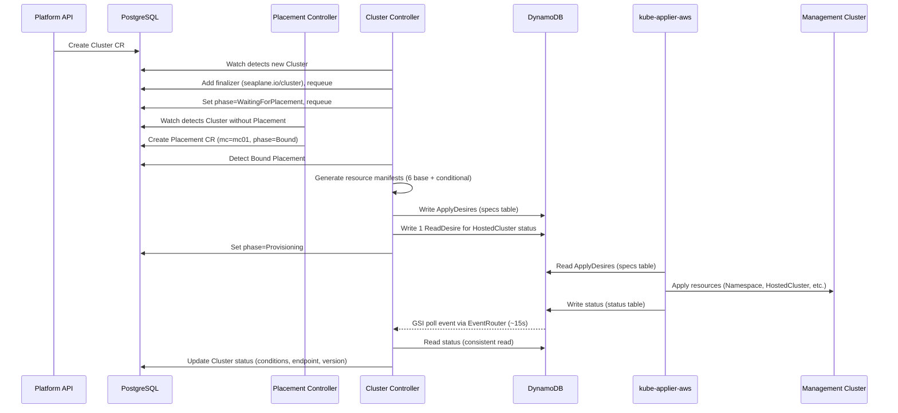
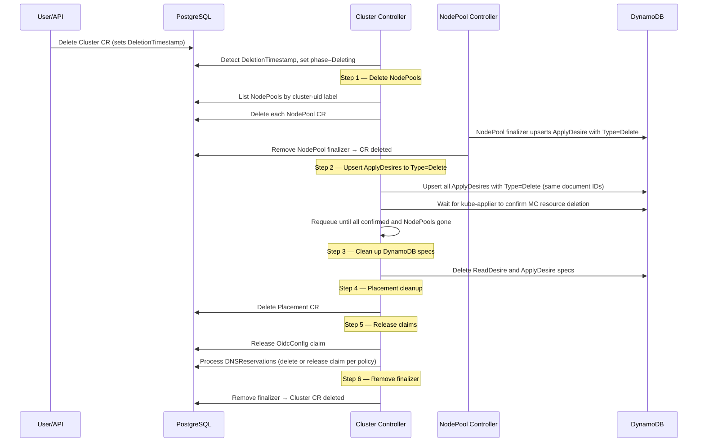

# Cluster Controller

## Naming Convention

`metadata.Name` is the client-chosen account-scoped name (a DNS label of at most
63 characters). `metadata.Namespace` is `account-<accountID>`. The owning AWS
account is also recorded in the `seaplane.io/account-id` label. All related
resources (NodePool, Placement, DNSReservation) share the same account namespace.

Cluster name uniqueness per account is enforced by PostgreSQL's unique constraint
on `(gvk, namespace, name)`.

## Creation Flow

### Reconcile Steps

1. **Finalizer**: Adds `seaplane.io/cluster` finalizer on first reconcile, requeues
2. **Placement lookup**: Waits for a Bound Placement (created by Placement controller)
3. **Manifest generation**: Generates base and conditional Kubernetes manifests (see below)
4. **ApplyDesires**: Writes one ApplyDesire per manifest to `{mc}-specs-applydesires`
5. **ReadDesire**: Creates a ReadDesire for the HostedCluster to get status feedback
6. **Status propagation**: Reads status from DynamoDB, propagates conditions/endpoint/version to Cluster CR
7. **Requeue**: Requeues every 5 minutes as a fallback; GSI two-speed polling via EventRouter provides the primary notification path (~15s latency)

### Generated Resources

The controller generates Kubernetes manifests for the management cluster: 6 base resources plus conditional resources depending on cluster configuration. It first creates a cluster-scoped Namespace named `cluster-<Cluster UID>`, then scopes the remaining resources within it:

**Base resources (always generated):**

| #   | Resource       | Name                      | Purpose                                                                |
| --- | -------------- | ------------------------- | ---------------------------------------------------------------------- |
| 1   | Namespace      | `cluster-<Cluster UID>`   | Cluster-scoped isolation boundary on the MC                            |
| 2   | ConfigMap      | `cluster-config`          | Cluster name and metadata                                              |
| 3   | ExternalSecret | `pull-secret`             | Pulls container registry credentials from AWS Parameter Store          |
| 4   | Certificate    | `api-serving-cert`        | TLS cert for `*.{name}.{prefix}.{shard}.{baseDomain}` via cert-manager |
| 5   | HostedCluster  | `{hostedClusterName}`     | HyperShift control plane definition                                    |
| 6   | Secret         | `ssh-key`                 | SSH key placeholder                                                    |

**Conditional resources:**

| Resource       | Name                      | Condition                                      |
| -------------- | ------------------------- | ---------------------------------------------- |
| ConfigMap      | `additional-trust-bundle` | When `spec.additionalTrustBundle` is set        |
| ExternalSecret | `oidc-signing-key`        | When the referenced OidcConfig is external/unmanaged |

### DNS reservation

DNSReservation is a customer-facing API resource. Customers can create a
DNSReservation before creating a Cluster in order to receive a base domain
(useful for shared-VPC or other DNS-dependent configuration). Alternatively,
when a Cluster is created without referencing a reservation, the operator
creates and claims one automatically.

The base domain is assembled as `{prefix}.{shard}.{baseDomain}` (e.g.
`f7a3.0.rosa.example.com`). The operator allocates a unique `prefix` within a
shard by creating an `Index` CR in the shard namespace — seaplane-db's
`(gvk, namespace, name)` unique constraint rejects duplicates. On conflict the
operator retries with a fresh prefix.

The DNSReservation also reports an `InternalHostedClusterName` in status. The
Cluster controller copies this into `spec.hostedClusterName`, which is then
used for the HostedCluster resource name on the management cluster.

A Cluster claims a reservation via the `seaplane.io/claimed-by-cluster-uid`
label. On Cluster deletion, the Cluster finalizer deletes reservations whose
`ClusterDeletionPolicy` is `Delete` (the default for operator-created
reservations) and releases the claim from retained reservations (customer
pre-created reservations that should outlive the Cluster). The reservation's own
finalizer releases only Indexes carrying its UID.

To use a customer-reserved DNS domain, set `spec.hostedCluster.dns.baseDomain`
on the Platform API create request. The API resolves that value to an
account-owned HCP DNS-domain reservation and sets the Cluster's
`spec.dnsReservationId`; the controller then uses the reservation's assigned
`status.baseDomain` when rendering the HostedCluster. A non-empty base domain
must belong to the configured regional suffix and have an account-owned
reservation. The reservation is atomically claimed by the cluster and released
when the cluster is deleted. If `baseDomain` is empty, the generated reservation
flow above is used. DNS zone IDs are platform-managed and are not accepted from
customers.
The Platform API exposes HCP DNS-domain reservations at
`/api/v0/dns_domains` and the ROSA-compatible
`/api/clusters_mgmt/v1/dns_domains` path. Configure the API's
`--dns-base-domain-suffix` to exactly the same suffix as the operator's
`--base-domain`; the API requires this flag at startup so reserved domains
resolve under the regional DNS zone.

## Deletion Flow

Deletion follows a strict ordering: NodePools first, then all MC resources (by upsetting existing ApplyDesires with `Type=Delete` so kube-applier removes them from the MC), then Placement, then OidcConfig/DNS claim release, then finalizer removal.

### Deletion Steps

1. **NodePool cascade**: Lists all NodePools carrying the Cluster's `seaplane.io/cluster-uid` label and deletes each one. Each NodePool's finalizer upserts its ApplyDesire with `Type=Delete` (see [NodePool deletion](nodepool-controller.md#deletion-flow)).
2. **ApplyDesire Type=Delete**: Upserts all ApplyDesires with `Type=Delete` using the same document IDs. kube-applier sees a MODIFY event per resource and deletes it from the MC. Waits for kube-applier to confirm all MC resources are deleted and all NodePools are gone.
3. **DynamoDB cleanup**: Deletes ReadDesire and ApplyDesire specs from DynamoDB.
4. **Placement cleanup**: Deletes the Placement CR.
5. **OidcConfig claim release**: Releases the claim this Cluster held on its referenced OidcConfig, freeing it for reuse.
6. **DNSReservation processing**: For each DNSReservation claimed by this Cluster: deletes reservations with `ClusterDeletionPolicy: Delete` (operator-created); releases the claim from retained reservations (customer pre-created).
7. **Finalizer removal**: Removes the `seaplane.io/cluster` finalizer, allowing the CR to be deleted.
